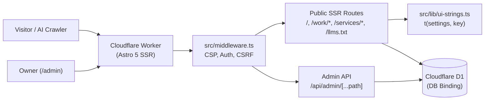

# Edge-Native Portfolio & Autonomous CMS

[](./LICENSE)
[](https://astro.build)
[](https://workers.cloudflare.com)
[](https://developers.cloudflare.com/d1/)
[](#pwa--offline-support)
[](./.github/workflows/ci.yml)

An edge-native, database-driven engineering portfolio and content management system built with **Astro 5 SSR**, **Cloudflare Workers**, and **Cloudflare D1**. Every single heading, paragraph, project case study, service detail page, navigation item, button caption, placeholder, empty state, and accessibility label on the site is controlled live from `/admin` with zero hardcoded public copy.

## Screenshots

> **TODO (Screenshots)**: Render and commit live browser captures at `390px` (mobile), `820px` (tablet), and `1440px` (desktop) in both Dark and Light themes under `docs/screenshots/`:
> - `docs/screenshots/390-dark.png` & `docs/screenshots/390-light.png`
> - `docs/screenshots/820-dark.png` & `docs/screenshots/820-light.png`
> - `docs/screenshots/1440-dark.png` & `docs/screenshots/1440-light.png`

## Key Features

- **100% Admin-Controlled Copy & Content**: No public text, label, button caption, placeholder, empty state, error message, `aria-label`, or link is hardcoded. Over 115 UI strings are registered in [`src/lib/ui-strings.ts`](./src/lib/ui-strings.ts) and editable in `/admin` → **Interface Text**.
- **Multi-Route SSR Architecture**:
  - `/` — Dynamic landing page with reorderable sections, interactive Hero Visual card, filterable projects, experience timeline, skills, proof/testimonials, FAQs, and contact form.
  - `/services/[slug]` — Standalone deep-dive pages for each engineering service with capabilities checklists and related services.
  - `/work` & `/work/[slug]` — Full project archive and structured engineering case studies (**01. Problem**, **02. Architecture & Solution**, **03. Results & Impact**).
- **AEO / GEO / SEO Engine**: Dynamic `/sitemap.xml`, `/robots.txt`, `/llms.txt`, `/llms-full.txt`, `/og-image.svg`, and a rich Schema.org `@graph` (`Person`, `ProfilePage`, `WebSite`, `ItemList`, `OfferCatalog`, `FAQPage`, `BreadcrumbList`, `SpeakableSpecification`).
- **Self-Hosted Typography & WCAG AA Contrast**: Self-hosted `Inter Variable`, `JetBrains Mono`, and `Material Icons Round` (`.woff2`) with zero external font calls and verified WCAG AA/AAA contrast across Dark and Light themes and all four accent presets (`emerald`, `teal`, `blue`, `indigo`).
- **Hardened Edge Security**: WebCrypto `PBKDF2-SHA256` (100k iterations) password hashing, HMAC-SHA256 signed `HttpOnly` sessions, per-session cryptographic CSRF tokens, RFC 6238 TOTP Two-Factor Authentication (2FA), IP rate limiting, and honeypot + elapsed-time bot protection.
- **Automated Prebuild Regression Guards**: Four build-time scripts verify admin inline script syntax and `onclick` handlers, `DEFAULT_SETTINGS` key usage, zero hardcoded public strings, and binary font/icon integrity.

## Everything Is Editable from `/admin`

Sign in at `/admin` to manage every aspect of the portfolio without touching code:

| Admin Panel | Capabilities |
| :--- | :--- |
| **Dashboard** | Live counts for visible projects, experiences, contact messages, unread badge, and active configuration summary |
| **Global Settings** | Owner name, site name, tagline, location, footer HTML, domain URLs, **editable Footer Links** (add/remove/reorder), and resume link |
| **Hero & About** | Headline lines, primary headline, subheadline, role text, status pill, primary/secondary CTAs, **Hero Visual Card** (toggle, `"chat+chart" \| "chart" \| "none"` variant, and all 19 card text fields), quick stats, about paragraphs, and pull quote |
| **Section Copy** | Eyebrow, heading title, and subtitle for every public section |
| **Interface Text** | Automatically generated from `src/lib/ui-strings.ts` — collapsible groups, live search box, default placeholders, and per-field reset buttons for all 117 UI strings |
| **Skills** | Skill groups, Material icons, ordering, visibility, and highlighted (`*`) skill pills |
| **Services** | Service cards and `/services/[slug]` detail pages (`slug`, short/long descriptions, key features list, CTA) |
| **Experience** | Work & internship timeline items with HTML-capable bullet points (`<strong>`, `<em>`, `<br>`) and technology tags |
| **Education** | Academic credentials, status/grade badges, bullet items, and coursework pills |
| **Projects** | Featured and archive projects with `/work/[slug]` case study fields (`problem`, `solution`, `result`, `stack`, `tags`, `github_url`, `demo_url`) |
| **Proof & Context** | Section heading, organizations heading/subtitle, testimonials heading, organization cards (with automatic initials badges), and testimonials |
| **FAQs (AEO/GEO)** | Questions and answers powering both the public FAQ accordion and `FAQPage` JSON-LD / `/llms-full.txt` |
| **Contact Config** | Direct email, LinkedIn, GitHub, main website URL, intro text, form enable toggle, and availability badge |
| **Inbox** | Read and manage contact form submissions stored in Cloudflare D1 |
| **Sections & Order** | Drag-and-drop section reordering and visibility toggles |
| **SEO / GEO / OG** | Meta title/description/keywords, OpenGraph tags, canonical URL, robots policy, and JSON-LD toggles |
| **Theme** | Default theme (`dark`, `light`, `system`), accent preset (`emerald`, `teal`, `blue`, `indigo`), `Glow Intensity` (`--glow-opacity`), and user toggle switch |
| **Security & 2FA** | Password rotation (revokes other active sessions) and TOTP 2FA authenticator setup |
| **Backup & Restore** | One-click full JSON export and restore across all tables and settings |

## Tech Stack

- **Framework**: [Astro 5](https://astro.build) (`output: 'server'`, SSR on Cloudflare Workers)
- **Adapter & Runtime**: [`@astrojs/cloudflare`](https://docs.astro.build/en/guides/integrations-guide/cloudflare/) + [Cloudflare Workers](https://workers.cloudflare.com) (Node.js compatibility enabled)
- **Database**: [Cloudflare D1](https://developers.cloudflare.com/d1/) (Serverless SQLite at the edge)
- **Styling**: Custom CSS Design System (`src/styles/tokens.css`, `src/styles/global.css`) with zero CSS framework bloat
- **Cryptography & Auth**: Web Standards Crypto API (`crypto.subtle` PBKDF2-SHA256, HMAC-SHA256, RFC 6238 TOTP)

## Architecture Diagram



## Project Structure

```text
.
├── .github/                  # CI workflow, Dependabot, CODEOWNERS, Issue & PR templates
├── docs/                     # Architecture, Design, Deployment, Admin Guide, and PWA docs
├── migrations/               # Additive D1 SQL migrations
├── public/                   # Self-hosted .woff2 fonts, PWA icons, sw.js, offline.html, manifest
├── scripts/                  # Prebuild verification & Wrangler preparation scripts
│   ├── check-admin.mjs             # Validates admin inline script syntax & onclick handlers
│   ├── check-assets.mjs            # Validates self-hosted woff2 fonts & icons on disk
│   ├── check-hardcoded-strings.mjs # Ensures public .astro templates route text via t()
│   ├── check-settings-usage.mjs    # Ensures all DEFAULT_SETTINGS keys are used in src/
│   └── prepare-wrangler.mjs        # Optional D1_DATABASE_ID injection for CI deployments
├── src/
│   ├── components/           # Public section components & reusable src/components/ui/* primitives
│   ├── layouts/              # BaseLayout.astro (public) & AdminLayout.astro (admin)
│   ├── lib/                  # auth.ts, db.ts, env.ts, response.ts, schema-sql.ts, seo.ts, ui-strings.ts
│   ├── pages/                # SSR routes (index, work/*, services/*, admin/*, api/*, llms*, sitemap, setup)
│   ├── styles/               # tokens.css, global.css, admin.css, docs.css
│   └── middleware.ts         # Edge security headers, session verification & CSRF token generation
├── schema.sql                # Full D1 SQLite table & index schema
├── seed.sql                  # Neutral starter seed data for fresh installations
├── package.json              # Scripts, metadata & dependencies
└── wrangler.jsonc            # Cloudflare Worker & D1 configuration (zero secrets)
```

## Quick Start (Local Development)

1. **Clone the repository and install dependencies**:
   ```bash
   git clone https://github.com/gulshanhex/portfolio.git
   cd portfolio
   npm install
   ```
2. **Create local environment variables**:
   ```bash
   cp .dev.vars.example .dev.vars
   ```
   Edit `.dev.vars` and set `SESSION_SECRET` and `ADMIN_SETUP_TOKEN`.
3. **Initialize the local D1 database**:
   ```bash
   npm run db:schema:local
   npm run db:seed:local
   ```
4. **Start the development server**:
   ```bash
   npm run dev
   ```
5. **Run first-time setup**:
   Open `http://localhost:4321/setup?token=YOUR_ADMIN_SETUP_TOKEN` to initialize your admin account, then sign in at `http://localhost:4321/admin`.

## Environment Variables & Secrets

Configure these in `.dev.vars` for local development and in **Cloudflare Dashboard → Worker → Settings → Variables and Secrets** (using **Secret** mode) for production:

| Variable | Required | Used By | Description |
| :--- | :---: | :--- | :--- |
| `SESSION_SECRET` | **Yes** | `src/lib/auth.ts`, `src/middleware.ts` | 32+ char random secret for HMAC-SHA256 session signing and CSRF token derivation |
| `ADMIN_SETUP_TOKEN` | **Yes** | `src/pages/setup.ts` | Token required to run `/setup?token=...` for initial D1 setup and admin creation |
| `ADMIN_ACCESS_KEY` | No | `src/middleware.ts` | Optional stealth gate key; requires `/admin?key=YOUR_KEY` before showing `/admin` |
| `SITE_URL` | No | `src/lib/env.ts`, `sitemap.xml.ts` | Fallback canonical site URL (e.g. `https://portfolio.example.com`) |
| `ADMIN_TOTP_SECRET` | No | `src/lib/auth.ts` | Optional Base32 TOTP secret to enforce 2FA via environment variable |
| `TURNSTILE_SECRET_KEY` | No | `.dev.vars.example` | Reserved for optional Cloudflare Turnstile contact form verification |
| `D1_DATABASE_ID` | No | `scripts/prepare-wrangler.mjs` | Optional CI build variable to override `database_id` in `wrangler.jsonc` |

## Cloudflare Deployment

1. **Create a D1 Database** (if you don't already have one):
   ```bash
   npx wrangler d1 create portfolio-cms-db
   ```
   Bind it as `DB` in `wrangler.jsonc`.
2. **Apply Schema or Migrations**:
   ```bash
   npm run db:schema:remote
   npm run db:migrate:remote
   ```
3. **Build and Deploy**:
   ```bash
   npm run deploy
   ```
   *(Runs `astro build && wrangler deploy --keep-vars` so Dashboard secrets are preserved.)*
4. **First-Run `/setup`**:
   Visit `https://your-worker-domain.com/setup?token=YOUR_ADMIN_SETUP_TOKEN` once to create your admin user and seed initial settings. See [docs/DEPLOYMENT.md](./docs/DEPLOYMENT.md) for full details.

## Theming & Design Tokens

- **Themes**: Dark (`#0A0C0B` background, `#1E2622` card surface at `1.27:1`, `#34423C` border at `1.86:1`) and Light (`#F6F7F4` background, `#FFFFFF` card surface) with automatic system detection and a header toggle.
- **Accents**: Four WCAG AA verified presets (`emerald`, `teal`, `blue`, `indigo`).
- **Glow Intensity**: Controlled via `theme.glow_intensity` (`data-glow="none" | "subtle" | "balanced" | "strong"` driving `--glow-opacity`).
- Full contrast ratios and token tables are documented in [docs/DESIGN.md](./docs/DESIGN.md).

## PWA & Offline Support

- Precaches self-hosted fonts, icons, and `/offline.html` via `Promise.allSettled` in `public/sw.js`.
- Syncs admin-edited `offline.*` strings and the active theme into `localStorage` so even offline fallback views reflect your custom copy.
- Provides a labelled **Install** button on desktop/tablet headers and a labelled **Install app** item inside the mobile **More** sheet and footer (automatically hidden in standalone mode). See [docs/PWA.md](./docs/PWA.md).

## NPM Scripts

| Script | Command | Description |
| :--- | :--- | :--- |
| `npm run dev` | `astro dev` | Start local Astro SSR development server |
| `npm run check` | `node scripts/check-*.mjs` | Run all four verification guards (`admin`, `settings`, `strings`, `assets`) |
| `npm run prebuild` | `npm run check && node scripts/prepare-wrangler.mjs` | Executed automatically before `npm run build` |
| `npm run build` | `astro build` | Build production Cloudflare Worker bundle into `dist/` |
| `npm run preview` | `astro build && wrangler dev` | Preview production Worker bundle locally with Wrangler |
| `npm run deploy` | `astro build && wrangler deploy --keep-vars` | Build and deploy to Cloudflare Workers preserving Dashboard secrets |
| `npm run db:schema:local` | `wrangler d1 execute ... --local --file=./schema.sql` | Apply SQL schema to local D1 database |
| `npm run db:seed:local` | `wrangler d1 execute ... --local --file=./seed.sql` | Seed neutral starter data into local D1 database |
| `npm run db:schema:remote` | `wrangler d1 execute ... --remote --file=./schema.sql` | Apply SQL schema to remote Cloudflare D1 database |
| `npm run db:migrate:remote` | `wrangler d1 execute ... --remote --file=./migrations/...` | Run additive Phase 4 slug and detail column migrations on remote D1 |

## Documentation

- [Architecture Overview](./docs/ARCHITECTURE.md)
- [Design System & WCAG Contrast Tokens](./docs/DESIGN.md)
- [Cloudflare Workers & D1 Deployment Guide](./docs/DEPLOYMENT.md)
- [Admin Panel & Interface Text Guide](./docs/ADMIN_GUIDE.md)
- [PWA & Service Worker Guide](./docs/PWA.md)

## Contributing, Security & License

- **Contributing**: Please read [CONTRIBUTING.md](./CONTRIBUTING.md) and our [Code of Conduct](./CODE_OF_CONDUCT.md) before opening a pull request.
- **Security**: Please report vulnerabilities privately per [SECURITY.md](./SECURITY.md) (never in public GitHub issues).
- **Third-Party Notices**: Font and package licenses are listed in [THIRD_PARTY_NOTICES.md](./THIRD_PARTY_NOTICES.md).
- **License**: The source code in this repository is licensed under the [MIT License](./LICENSE) (`Copyright (c) 2026 Gulshan Kumar`).

### Content and Branding Notice

The **source code, architecture, and UI components** of this project are released under the [MIT License](./LICENSE). However, the portfolio owner's personal name (`Gulshan Kumar`), biographical copy, work history, photos, and personal branding/logos stored in production databases or commit history are **not licensed for reuse**. When deploying your own instance, use the neutral defaults or customize your identity via `/admin`.
