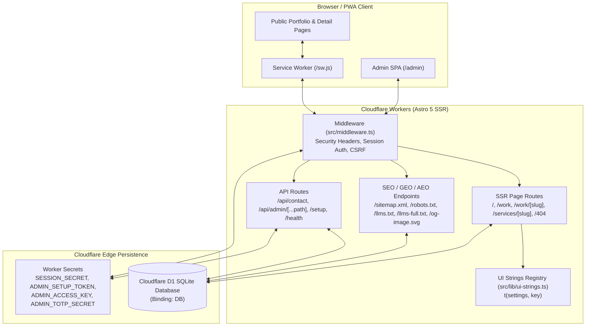

# Architecture Overview

This document describes the runtime, database, routing, and security architecture of **GK Portfolio CMS** (`gk-portfolio-astro`).

## 1. High-Level System Architecture

## 2. Core Design Principles

1. **Zero Hardcoded Public Copy (`src/lib/ui-strings.ts`)**:
   - Every visible sentence, heading, button label, placeholder, empty state, error message, `aria-label`, and `title` attribute on the public site is resolved at request time from Cloudflare D1 (`site_settings` + entity tables) with fallbacks defined in `src/lib/ui-strings.ts` via `t(settings, key)`.
   - Overrides saved in `/admin` → **Interface Text** are stored as a flat JSON map under `site_settings.ui`.
2. **Idempotent Schema & Lazy Migrations (`src/lib/schema-sql.ts`, `src/lib/db.ts`)**:
   - `ensureDatabaseSchema(db)` safely creates tables, columns, and unique slug indexes without dropping existing data.
   - `runLazyLabelMigrations(db)` executes once behind the `site_settings._migrations` flag (`{"v3_labels_v1":true}`), updating only unedited legacy default strings while preserving any custom user edits.
3. **Sample Data Isolation**:
   - `DEFAULT_*` arrays in `src/lib/schema-sql.ts` are used as runtime fallbacks **only** when the Cloudflare `DB` binding is undefined in local development.
   - When `DB` is bound and a table has `0` visible rows, the corresponding public section hides cleanly instead of leaking sample data.

## 3. Request Lifecycle & Middleware (`src/middleware.ts`)

Every incoming request passes through `src/middleware.ts`:
1. **Security Headers**: Attaches `Content-Security-Policy`, `X-Content-Type-Options: nosniff`, `X-Frame-Options: DENY`, `Referrer-Policy: strict-origin-when-cross-origin`, and `Permissions-Policy`.
2. **Optional Stealth Gate (`ADMIN_ACCESS_KEY`)**: When `ADMIN_ACCESS_KEY` is configured in Worker Secrets, visiting `/admin` without a valid session requires passing `?key=YOUR_ACCESS_KEY` once, which sets an `HttpOnly` gate cookie (`gk_admin_gate`).
3. **Session & CSRF Verification**:
   - Reads the `gk_session` cookie, verifies its WebCrypto HMAC-SHA256 signature using `SESSION_SECRET`, and checks `admin_sessions` in D1.
   - Derives a deterministic per-session HMAC-SHA256 `csrfToken` (`locals.csrfToken`) injected into `

` and verified via the `X-CSRF-Token` header on all mutating `/api/admin/*` requests.

## 4. Database Schema (`schema.sql`)

| Table | Purpose |
| :--- | :--- |
| `admin_users` | Admin credentials (`PBKDF2-SHA256` hash) and optional TOTP 2FA secret/status |
| `admin_sessions` | Active session tokens, expiration timestamps, IP, and User-Agent |
| `login_attempts` | Per-IP login rate-limiting log (blocks brute-force attempts) |
| `site_settings` | Key-value JSON settings (`global`, `hero`, `about`, `copy`, `contact`, `seo`, `theme`, `nav`, `proof_section`, `ui`) |
| `sections` | Section ordering (`order_idx`), navigation labels, and visibility toggles |
| `skills` / `skill_pills` | Skill categories and individual technology pills (`is_hot` highlight flag) |
| `services` | Service cards and `/services/[slug]` detail page content (`slug`, `long_description`, `features`) |
| `experiences` | Work history and internship timeline items (`bullet_points`, `tags`) |
| `education` | Academic credentials, coursework bullets, and skill pills |
| `projects` | Portfolio projects and `/work/[slug]` case studies (`slug`, `problem`, `solution`, `result`) |
| `proof_items` | Organizations (`type = 'org'`) and testimonials (`type = 'testimonial'`) |
| `faqs` | Frequently asked questions rendered on the page and in `FAQPage` JSON-LD |
| `contact_submissions` | Messages submitted via `/api/contact` |
| `audit_log` | Admin configuration and security event log |

## 5. Prebuild Verification Pipeline

Four automated Node scripts run during `npm run prebuild` (and `npm run check`):
- [`scripts/check-admin.mjs`](../scripts/check-admin.mjs): Verifies `<script is:inline>` syntax via `node --check`, blocks `define:vars` IIFE wrapping, verifies `async function loadHero()`, and checks that every `onclick="..."` handler function is declared at top level.
- [`scripts/check-settings-usage.mjs`](../scripts/check-settings-usage.mjs): Verifies every key in `DEFAULT_SETTINGS` is read in non-admin source files.
- [`scripts/check-hardcoded-strings.mjs`](../scripts/check-hardcoded-strings.mjs): Scans public `.astro` templates to ensure zero static text nodes or accessibility attributes bypass `t(settings, key)`.
- [`scripts/check-assets.mjs`](../scripts/check-assets.mjs): Validates self-hosted `.woff2` font headers, icons, and PWA assets on disk.

See also:
- [Design System & Tokens](./DESIGN.md)
- [Admin Panel & UI Strings Guide](./ADMIN_GUIDE.md)
- [Cloudflare Deployment Guide](./DEPLOYMENT.md)
- [PWA & Service Worker Architecture](./PWA.md)
